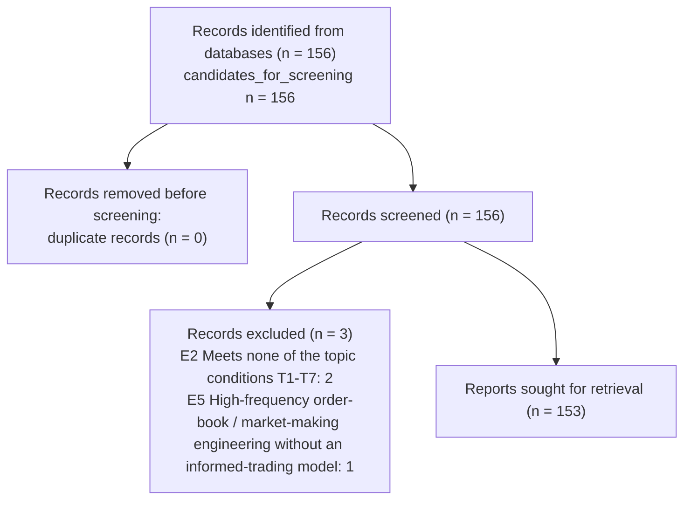

# PRISMA 2020 counts - title/abstract stage



```json
{
 "stage": "ta",
 "tool": "sr-screener 1.0.0",
 "complete": true,
 "pending_records": 0,
 "state_problems": [],
 "identified_by_database": {
  "candidates_for_screening": 156
 },
 "identified_total": 156,
 "duplicates_removed": 0,
 "records_screened": 156,
 "records_to_screen": 156,
 "records_excluded": 3,
 "excluded_by_code": {
  "E2": 2,
  "E5": 1
 },
 "reports_sought_for_retrieval": 153,
 "advanced_include": 111,
 "advanced_unclear": 42,
 "advanced_outside_allowed_languages": 0,
 "agreement": {
  "n": 156,
  "both_advance": 143,
  "both_exclude": 5,
  "a_only_advance": 6,
  "b_only_advance": 2,
  "observed_agreement": 0.9487,
  "kappa": 0.53,
  "pabak": 0.897,
  "conflicts": 8,
  "resolved_by": {
   "A+B": 146,
   "ADJ": 8,
   "QC": 2
  }
 },
 "decided_by": {
  "A+B": 146,
  "ADJ": 8,
  "QC": 2
 }
}
```
